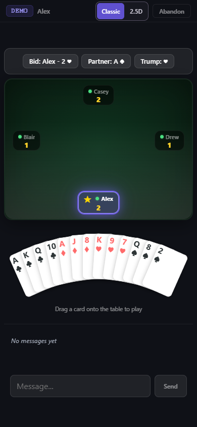
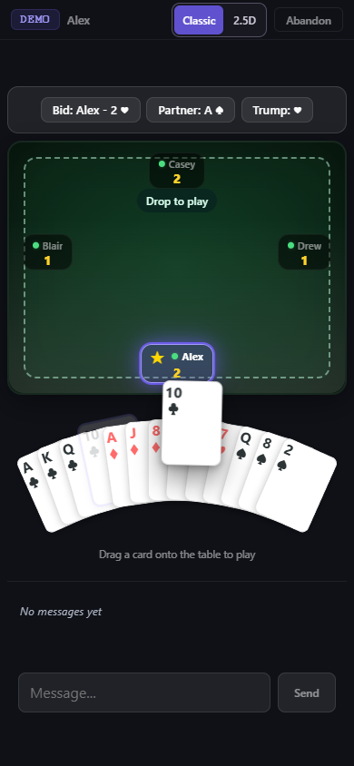
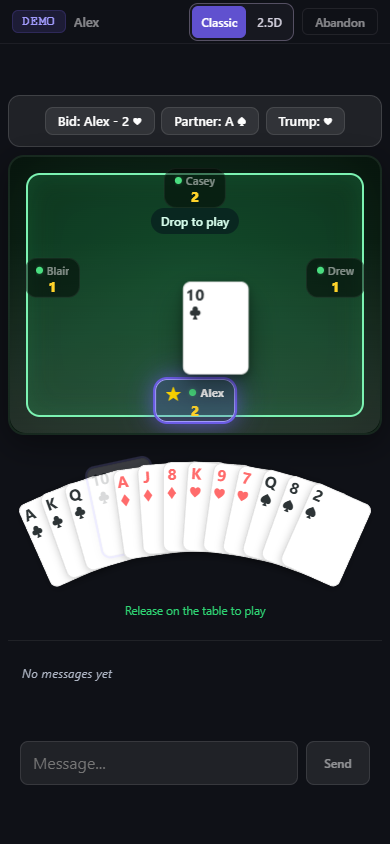
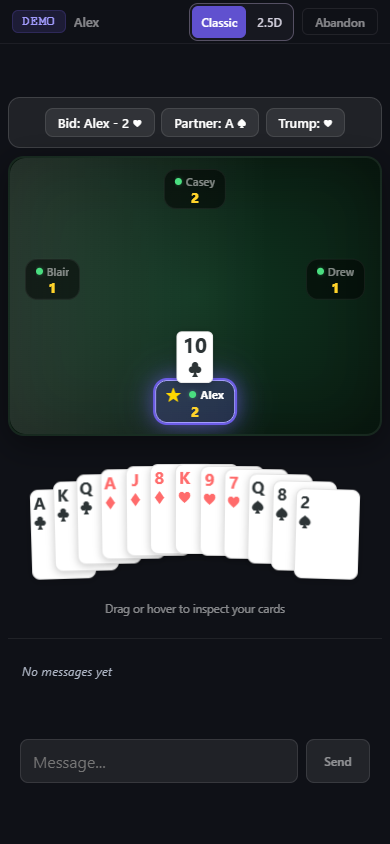
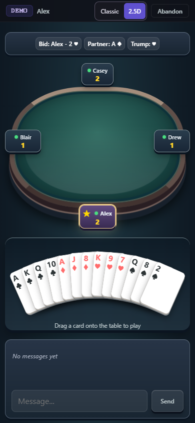
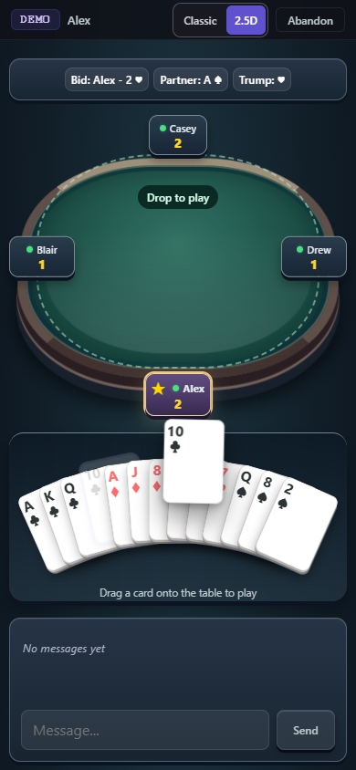
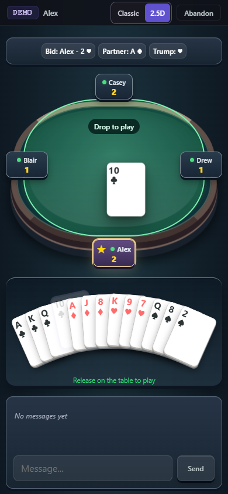
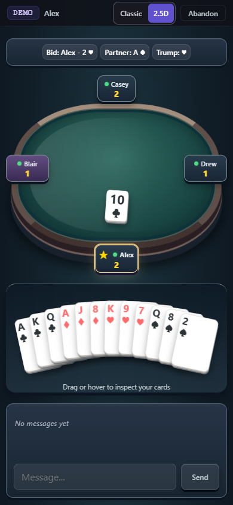

# Drag a card onto the table

Touch or pen input now grabs a card directly. Its grab point follows the
finger exactly; a damped tilt and lifted shadow add weight while moving. A
legal card enables a visible table drop area, which turns green under the
release point. Releasing there submits one play. Releasing over the hand,
outside the highlighted table, or after cancellation returns the card with
a short spring. Reduced motion uses direct tracking and immediate returns.

The curved fan, original card typography, mouse hover/click and keyboard
Enter/Space controls remain shared. The real card retains its DOM position
and accessibility semantics; the moving copy is inert and hidden from
assistive technology. Only one moving copy and one animation frame loop are
needed, with no physics dependency. Outside-card page scrolling remains
available. A reconnect begins a fresh input session and returns a held card
before authoritative state re-enables play.

## Actual browser captures

Synthetic game data rendered in system Chrome at 390 × 844, using real CDP
touch input. These recordings demonstrate return-to-hand followed by a legal
table drop. A synthetic authoritative acknowledgement displays the played
card in the trick; separate live E2E exercises real Worker/WebSocket play.

| View | Resting | Dragging | Eligible table drop | Played |
| --- | --- | --- | --- | --- |
| Classic |  |  |  |  |
| 2.5D |  |  |  |  |

[Classic gesture recording](classic-drag-return-drop.webm) ·
[2.5D gesture recording](25d-drag-return-drop.webm)

Regenerate using an already installed Chrome and Playwright FFmpeg runtime:

```powershell
$env:PLAYWRIGHT_CHANNEL = 'chrome'
$env:DRAG_CAPTURE = '1'
npx playwright test tests/ui/card-drag.pw.js --grep 'capture synthetic' --output .wrangler/card-drag-capture
```

Run `npm run test:pr` for typecheck, focused unit checks, real multiplayer and
chat E2E, new drag/drop cases, and the complete hand suite in both views.
See [the repeatable workflow](../testing.md). Physical iPhone/Android, Safari,
Telegram WebViews and screen readers require separate device verification;
Chrome mobile emulation is not physical device coverage.
