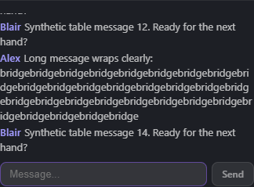
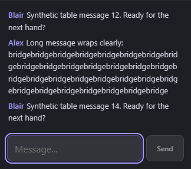
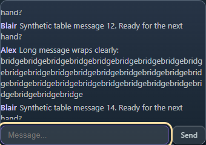
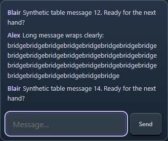
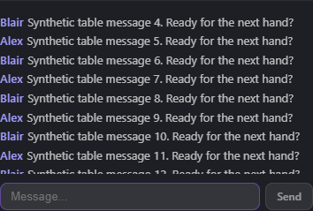
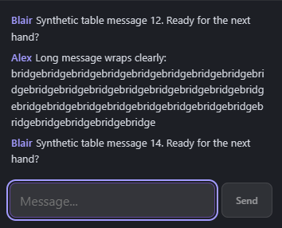
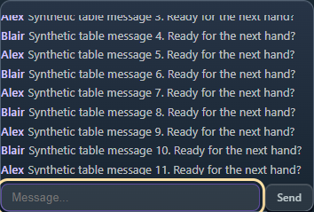
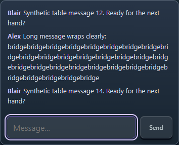

# Chat and input review

Actual Chrome captures using synthetic players/messages. Before images are
from merged PR68 (`ceed5b5`); after images show this branch. The user's uploaded
reference was inspected privately and is not included in the repository.

| View / viewport | Before | After |
| --- | --- | --- |
| Classic, 390 × 900 |  |  |
| 2.5D, 390 × 900 |  |  |
| Classic, 1366 × 900 |  |  |
| 2.5D, 1366 × 900 |  |  |

The log now has horizontal/vertical padding, non-shrinking wrapped rows, a dark
thin scrollbar, and a quiet visible composer focus indicator. Existing readers
retain their position; readers at the bottom follow new messages. The input
and Send button retain 44px minimum height at narrow widths.

The server keeps the latest 50 messages in a separate room-local Durable Object
record. Join/rejoin snapshots use generation and sequence IDs to merge with
live arrivals without duplicates. The existing room inactivity cleanup removes
that record; recreating a room starts a new generation. Messages that disappeared
before this implementation cannot be recovered retroactively.

Unchanged hands retain their actual card nodes and positions across unrelated
state updates. Card-started touch gestures own their scroll handling from first
contact; scrolling remains available outside the cards. Pointer Events provide
the single selection/play path, retaining turn, legality and pending guards.
The completed-trick guard now permits the winner to lead the next trick, matching
the server's existing transition instead of permanently blocking the next lead.

See [PR validation](../testing.md) for reproducible E2E commands and coverage.
Chrome mobile emulation and CDP touch are not physical iPhone/Safari tests.
