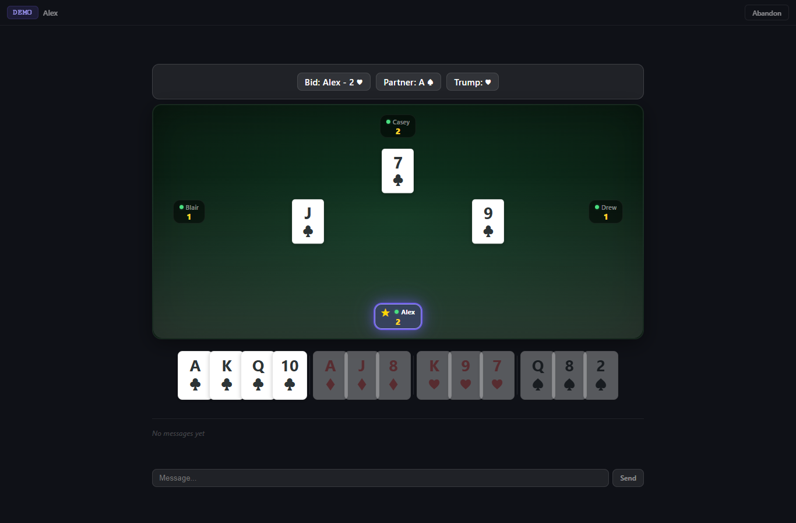
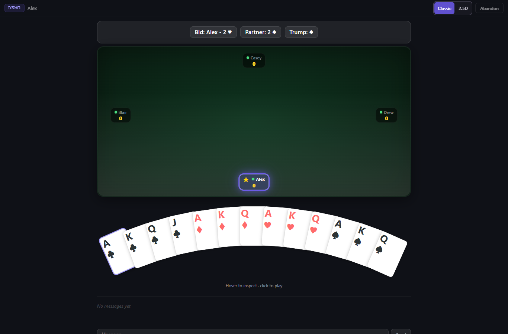
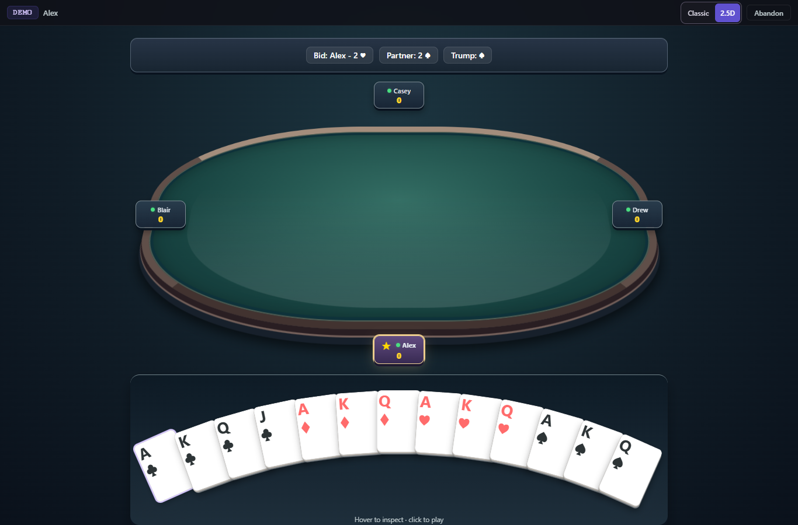
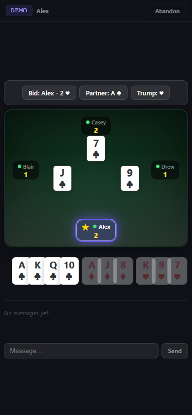
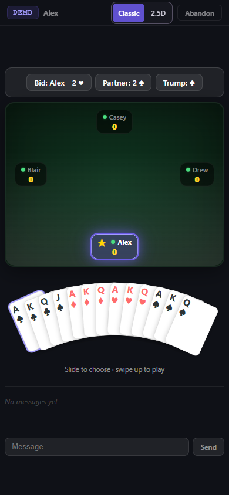
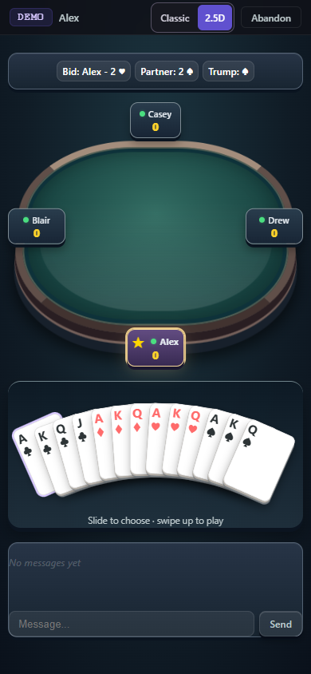

# Curved hands, in-place selection and optional 2.5D

PR68 combines the responsive curved hand with the player-selectable 2.5D view.
Classic remains the default. The original card font and suit proportions are
preserved. Selection lifts the existing card modestly within its fan position,
retaining its rotation and neighboring rank/suit visibility.

Desktop hover/click, touch hold/drag selection and upward-swipe-only play,
keyboard navigation, legality/pending guards, spectator hands and reduced motion
are shared by both views. Changing view retains the room, state, socket and hand.
There are no production server, account, rule or protocol changes.

## Actual browser evidence

These are Chrome captures of the real frontend using deterministic synthetic
players and cards, with external fonts/widgets, APIs and real rooms blocked.
The before images are preserved actual captures of master `5ab300a` from the
original feature work. After images and recordings are generated from the final
combined code with the selected card lifted in place.

| Original desktop | Classic with selected card | Optional 2.5D with selected card |
| --- | --- | --- |
|  |  |  |

| Original phone | Classic with selected card | Optional 2.5D with selected card |
| --- | --- | --- |
|  |  |  |

| Detail | Classic | 2.5D |
| --- | --- | --- |
| 320px phone | [Screenshot](classic/after-play-320.png) | [Screenshot](25d/after-play-320.png) |
| Landscape | [Screenshot](classic/after-play-844.png) | [Screenshot](25d/after-play-844.png) |
| Bidding | [Screenshot](classic/after-bidding-390.png) | [Screenshot](25d/after-bidding-390.png) |
| Partner selection | [Screenshot](classic/after-partner-390.png) | [Screenshot](25d/after-partner-390.png) |
| Touch selection, drag and swipe | [Recording](classic/touch-select-slide-swipe.webm) | [Recording](25d/touch-select-slide-swipe.webm) |

The [phase gallery](../table-view/final) also includes lobby, bidding, partner
selection, active tricks, last-trick display and results at desktop/phone widths.

## Reproduce

Final local validation: **111 unit tests**, type checking and JavaScript syntax
checks pass. All **74 browser checks/captures/recordings pass in Classic and all
74 pass in 2.5D**. Coverage includes 320/390px phones, desktop widths through
1920px, landscape, nested 270px panels, hover/focus/touch lift without clipping
or covering neighboring glyphs, drag/swipe/cancellation, invalid/pending actions,
mid-game toggles, an armed-swipe toggle, spectators, reduced motion and phase
layouts. Both rendered-font audits exactly match the original baseline.

Classic's optional table-style comparison restores the same pixels after a view
switch. The curved hand itself is the shared new behavior in both modes.
See [Classic font audit](../hand-fan/font-audit-combined-classic.json) and
[2.5D font audit](../hand-fan/font-audit-combined-25d.json).

```powershell
npm ci
npm test -- --maxWorkers=2
npm run typecheck
$env:PLAYWRIGHT_CHANNEL = 'chrome'
$env:HAND_TABLE_VIEW = 'classic' # Repeat with '25d'.
$env:HAND_FAN_CAPTURE = 'after'
$env:HAND_FAN_RECORD = '1'
$env:HAND_FONT_AUDIT = 'combined-classic' # Use 'combined-25d' for 2.5D.
$env:VIEW_CAPTURE = 'final'
npm run test:ui -- --workers=1
```

Browser tests use one worker and separate static-server ports (4184 and 4186).
Recording uses Playwright's FFmpeg helper. Ordinary tests work without the
optional capture, recording and font-audit environment variables.

Physical devices, Firefox and WebKit are outside this synthetic Chrome evidence.
No pull request merge or deployment is performed as part of preparing the review.
