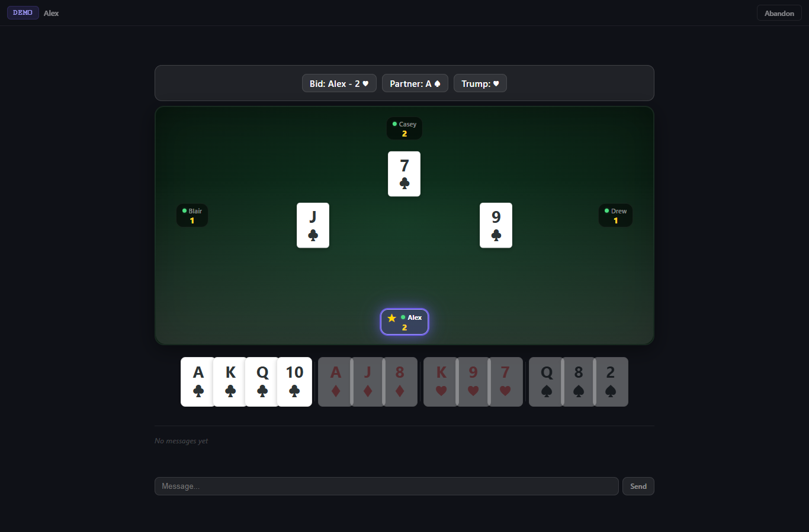
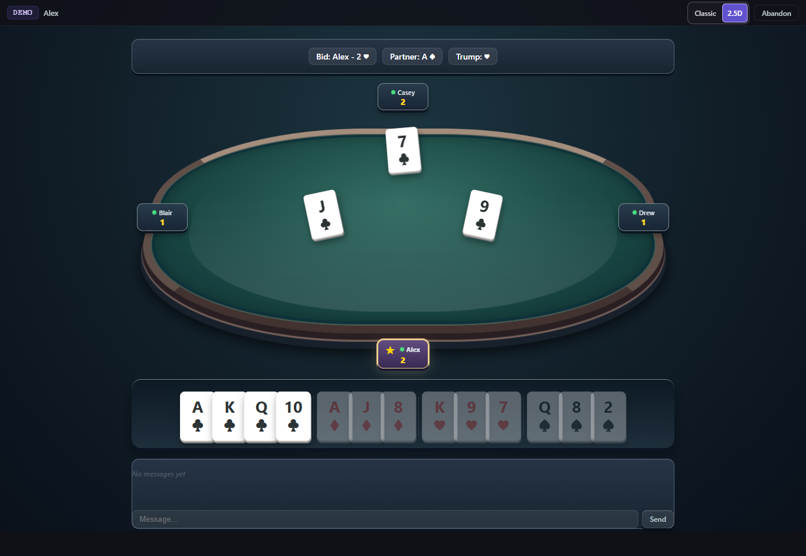
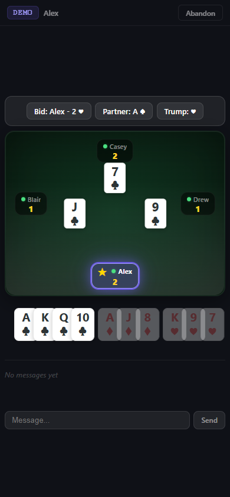
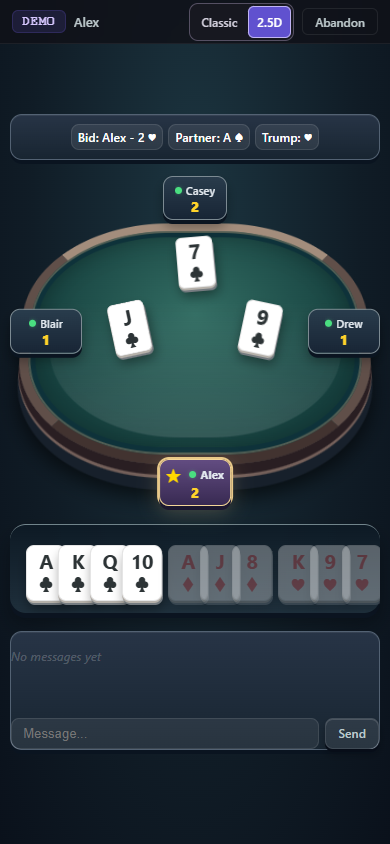

# Optional 2.5D table

Players can choose **Classic / 2.5D** from the home screen or the in-game top bar. Classic is the default. The preference is stored locally as `bridge.tableView`; unavailable storage falls back to the session. Switching changes presentation and accessibility attributes without replacing cards, resetting a room, reconnecting, or sending a move.

The additional view includes a perspective felt plane, layered rim, upright player seating, shallow card depth, and matching raised panels for home, lobby, bidding, partner selection, results, and shared spectator/chat controls. The interactive hand retains the existing layout, typeface, hit targets and input behavior. On narrow screens the last-trick panel moves below the table. Long screens use document scrolling. Motion is disabled under `prefers-reduced-motion: reduce` in this mode; no rendering loop or new runtime dependency is added.

`static/style.css`, `static/app.js`, game logic, protocol, authentication, and server code are unchanged. The visual rules live in `static/view.css` under `body[data-table-view="25d"]`. Legacy playable div cards gain Enter/Space support only in 2.5D; native buttons and controls with existing semantics are left to their renderer. This keeps the separate hand/gesture work independent.

## Actual browser captures

All images are headless Chrome screenshots of the real frontend using deterministic synthetic players and hands. External fonts/widgets, APIs, accounts, and real rooms are excluded. Before images use the original HTML at master `5ab300a`; the committed fixture makes this reproducible with shallow checkouts. The same existing `app.js` and `style.css` render both the baseline and Classic comparison.

| Desktop before | Desktop 2.5D |
| --- | --- |
|  |  |

| Mobile before | Mobile 2.5D |
| --- | --- |
|  |  |

| Phase / detail | Desktop, 1366 px | Mobile, 390 px |
| --- | --- | --- |
| Lobby | [Screenshot](final/25d-lobby-1366.png) | [Screenshot](final/25d-lobby-390.png) |
| Bidding | [Screenshot](final/25d-bidding-1366.png) | [Screenshot](final/25d-bidding-390.png) |
| Partner selection | [Screenshot](final/25d-partner-1366.png) | [Screenshot](final/25d-partner-390.png) |
| Results | [Screenshot](final/25d-gameover-1366.png) | [Screenshot](final/25d-gameover-390.png) |
| Last trick | [Screenshot](final/25d-lasttrick-1366.png) | [Screenshot](final/25d-lasttrick-390.png) |
| Current Classic, including toggle | [Screenshot](final/classic-play-1366.png) | [Screenshot](final/classic-play-390.png) |

The [early desktop](early/25d-play-1366.png) and [early mobile](early/25d-play-390.png) images were shared before final polish.

## Validation

- `npm test -- --maxWorkers=2`: 111 tests passed.
- `npm run typecheck`: passed.
- Existing hand suite: 21 checks passed; its optional screenshot refresh is skipped.
- New view suite: 14 checks passed with screenshot capture enabled.
- Classic play-area pixels match the original baseline byte for byte and restore after toggling. The added toggle is intentionally outside that comparison.
- Both modes cover lobby, bidding, partner selection, play and results at 320, 390, 768 and 1366 px, with no document overflow and single legal actions.
- Mid-trick toggles preserve the identical game-state object, socket, card nodes, chat draft and legal-suit constraints; touch scrolling retains its position.
- The real frontend WebSocket connection/message handlers are exercised against a synthetic socket peer: one join, one play, incoming state updates, no reconnect or close during switching.
- Keyboard activation, held-key suppression, native control semantics, out-of-turn actions, practice styling, full-board spectator hands, reduced motion, completed tricks, long names, and last-trick/hand separation are covered.

Reproduce on PowerShell with installed Chrome:

```powershell
npm ci
$env:PLAYWRIGHT_CHANNEL = 'chrome'
npm run test:ui
# Refresh the committed synthetic evidence when intentionally updating the design:
$env:VIEW_CAPTURE = 'final'
npx playwright test tests/ui/table-view.pw.js --workers=1
```

Tests use one browser worker. The new suite's synthetic static server uses port **4186**, separate from the existing hand suite's 4174. With Playwright-managed browsers, omit `PLAYWRIGHT_CHANNEL`.

## Integration and limits

This branch starts at master `5ab300a` after PR67. It contains no commits from PR68 or the older PR66. Its asset entries are separated from PR68's hand script entry to reduce merge conflicts, and its keyboard adapter skips native/annotated card controls. PR68 was still open at review, at `1f97fa4` (a docs-only preview addition after `c0ba4c9`; production code is unchanged).

`git merge-tree --write-tree` produced clean simulated merges with both PR68 heads. In a separate extracted copy of the combined `c0ba4c9` tree, all 13 functional view checks passed, including exposed-edge mouse selection, touch swipes, keyboard handling, Classic pixel restoration and mid-game toggling. The screenshot-refresh check was skipped there. The test fixtures accept authoritative state messages and retain independent renderer scripts so they work with both renderers. This does not include later unpublished curved-fan/font implementation changes.

The browser evidence is synthetic frontend coverage, not a live four-player or real-device session. Mobile keeps the existing scrollable hand until the separate hand feature lands. Bidding, partner selection and results use coherent raised panels rather than duplicating the play table. No deployment or merge is performed.
