# Table drag and lobby polish

Synthetic browser captures of the merged base `caf89d0033f37b8e43e0cabda3eb1711cd1e353a`
and this change, using the same fixtures, Chrome, viewport and pointer paths.
These are test players and local data, not production screenshots. The private
reference images are not included.

The drop highlight now belongs to the same perspective surface as the felt,
and native hit testing follows that rounded surface. The wooden rim and the
empty corners outside the felt do not accept a drop in 2.5D. Classic uses its
existing rounded rectangular table surface.

| Comparison | Before | After |
| --- | --- | --- |
| 2.5D drop surface, 390 × 844 | 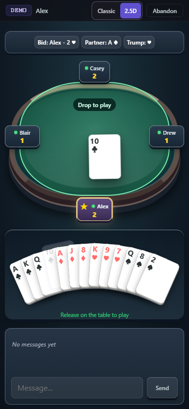 | 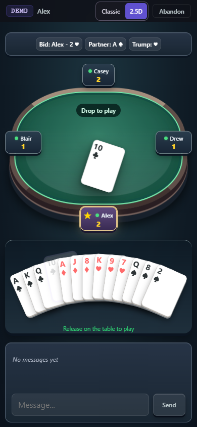 |
| 2.5D lobby, 390 × 844 | 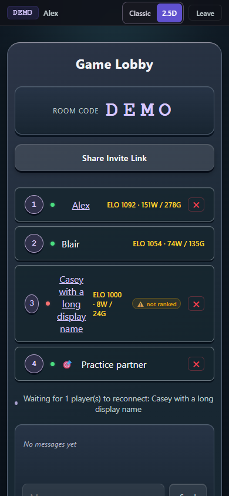 | 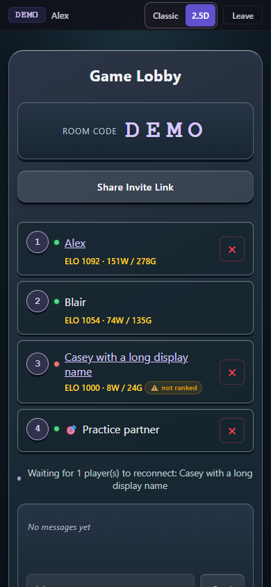 |
| Classic drop surface, 390 × 844 | 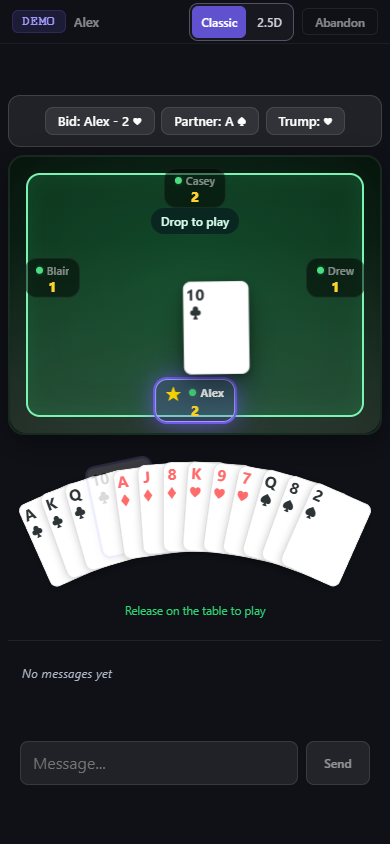 | 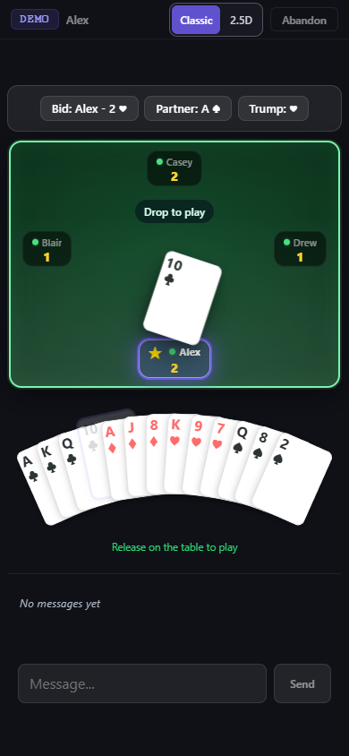 |
| Classic lobby, 390 × 844 | 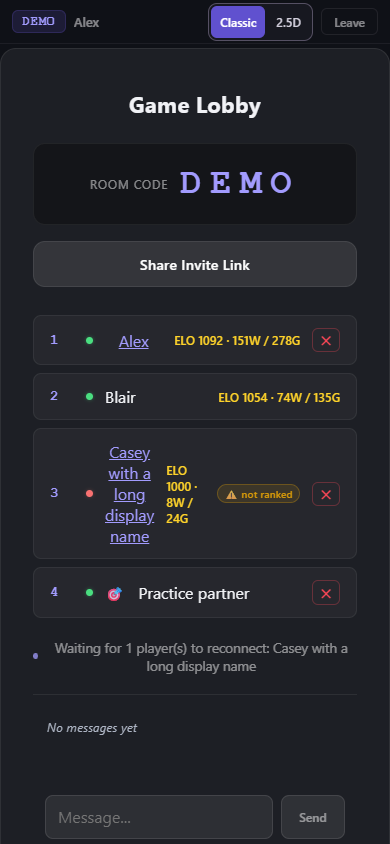 | 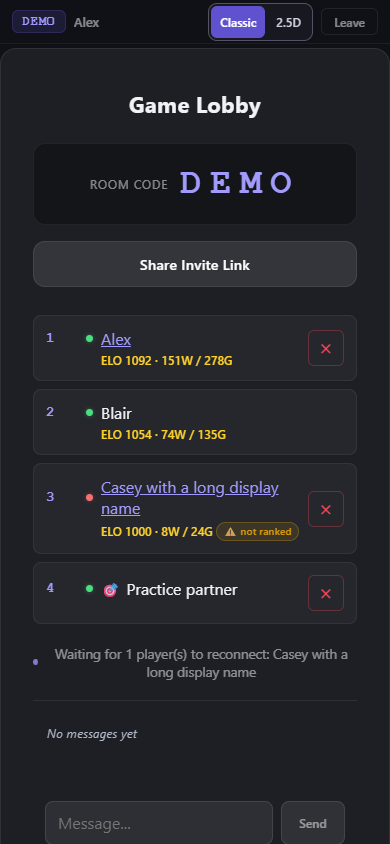 |
| 2.5D desktop after a play, 1366 × 900 | 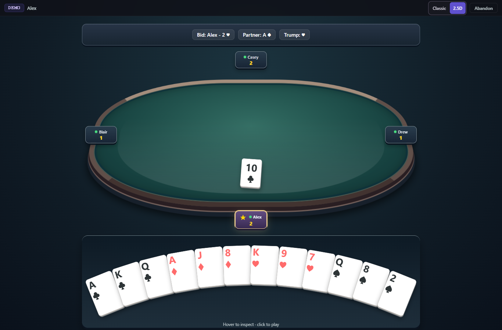 | 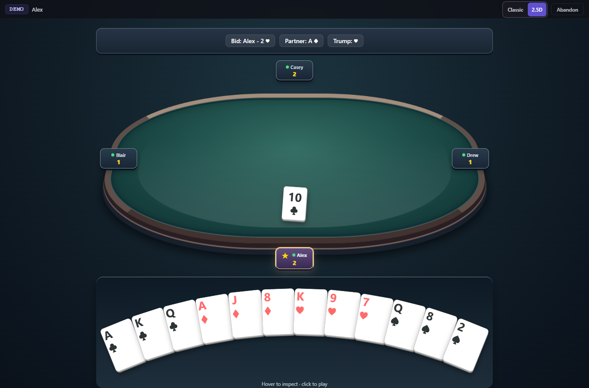 |
| Classic desktop after a play, 1366 × 900 |  | 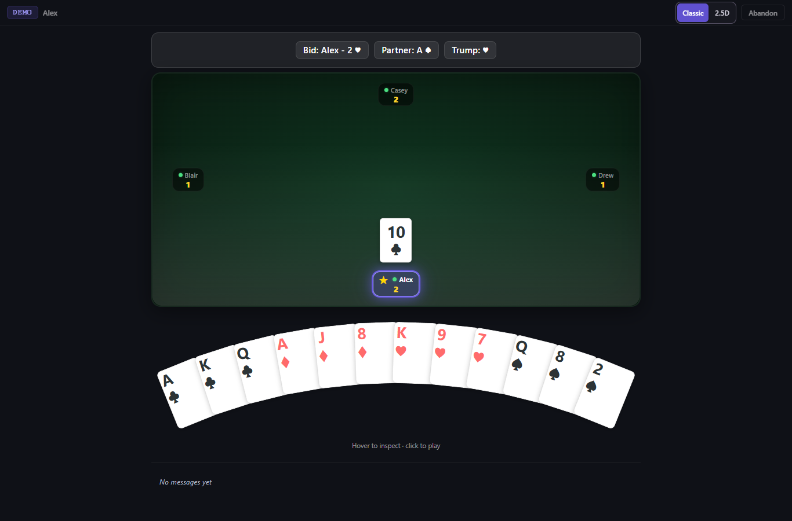 |

Motion is easier to assess in the browser recordings:

- 2.5D grip swing and return: [before](before-25d-swing.webm), [after](after-25d-swing.webm).
- Classic grip swing and return: [before](before-classic-swing.webm), [after](after-classic-swing.webm).
- Desktop click, acknowledgement and remaining-card reflow in both views: [before](before-desktop-fan.webm), [after](after-desktop-fan.webm).

The drag translation follows the finger directly. Only rotation swings around
the actual grip, reacting to acceleration and direction changes before damping
to a readable hanging angle. Reduced motion keeps direct tracking and removes
the swing and return animation. A legal release on the felt remains the only
touch path that plays a card; swinging or moving quickly cannot play it.

Remaining hand buttons survive authoritative card removal and reflow once.
The hand keeps its canvas height through that deal so the centered table does
not bob. Mouse play does not lift another card through focus restoration;
keyboard play keeps focus at the nearest surviving card. New deals and resizes
establish a fresh canvas.

Lobby rows reserve the seat, status, name, statistics and action columns even
when the current player has no remove button. Statistics stack below names on
narrow screens; long names wrap, and ping/remove actions retain their behavior
and explicit accessible labels.

Capture with existing Chrome and Playwright FFmpeg, one stage at a time:

```powershell
$env:PLAYWRIGHT_CHANNEL = 'chrome'
$env:UI_POLISH_CAPTURE = 'before' # or 'after'
npx --no-install playwright test tests/ui/ui-polish.pw.js --grep 'capture synthetic' --output .wrangler/ui-polish-capture
```

`before` serves only the four changed static files from the immutable merged
base using `git show`; it never replaces working-tree files. Video recording
also needs the existing Playwright FFmpeg path in `PLAYWRIGHT_BROWSERS_PATH`.
The optional recording is skipped during ordinary validation.

See [validation](validation.md) for the exact automated coverage and limits.
